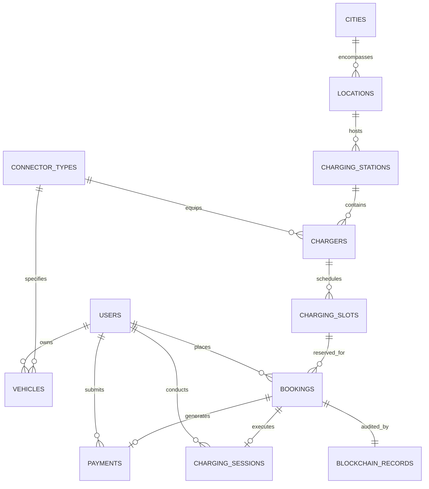

# VoltReserve — Database Design Specification

## 1. Entity-Relationship Diagram (ERD)

---

## 2. Table Catalog & Constraint Definitions

### `users`
Operational identity table for customers and network station administrators.
- `id` (BIGINT, Primary Key, AUTO_INCREMENT)
- `email` (VARCHAR(120), UNIQUE, NOT NULL)
- `password_hash` (VARCHAR(255), NOT NULL, BCrypt format)
- `full_name` (VARCHAR(100), NOT NULL)
- `phone` (VARCHAR(20), NOT NULL)
- `role` (VARCHAR(20), NOT NULL, DEFAULT `'ROLE_USER'`)
- `is_active` (BOOLEAN, NOT NULL, DEFAULT `TRUE`)
- `created_at`, `updated_at` (TIMESTAMP)

### `connector_types`
Standard EV plug standards supported across charging stations and vehicle inlet designs.
- `id` (BIGINT, Primary Key, AUTO_INCREMENT)
- `code` (VARCHAR(30), UNIQUE, e.g. `'CCS2'`, `'TYPE2'`, `'CHADEMO'`, `'GBT'`)
- `name` (VARCHAR(80), NOT NULL)
- `current_type` (ENUM(`'AC'`, `'DC'`), NOT NULL)
- `max_power_kw` (DECIMAL(6,2), NOT NULL)
- `description` (VARCHAR(255))

### `vehicles`
User EV garages, storing battery capacity and connector inlet compatibility.
- `id` (BIGINT, Primary Key, AUTO_INCREMENT)
- `user_id` (BIGINT, Foreign Key -> `users.id` ON DELETE CASCADE)
- `make` (VARCHAR(50), NOT NULL)
- `model` (VARCHAR(50), NOT NULL)
- `variant` (VARCHAR(50))
- `battery_capacity_kwh` (DECIMAL(6,2), NOT NULL)
- `max_charging_rate_kw` (DECIMAL(6,2), NOT NULL)
- `connector_type_id` (BIGINT, Foreign Key -> `connector_types.id`)
- `license_plate` (VARCHAR(30), NOT NULL)

### `cities` & `locations`
Geographic hierarchy for station discovery across metropolitan regions.
- `cities`: `id`, `name`, `state`, `country`, `latitude`, `longitude`.
- `locations`: `id`, `city_id` (FK), `name`, `address`, `landmark`, `postal_code`, `latitude`, `longitude`.

### `charging_stations`
Central commercial hubs containing charging dispensers and amenities.
- `id` (BIGINT, Primary Key, AUTO_INCREMENT)
- `location_id` (BIGINT, Foreign Key -> `locations.id`)
- `name` (VARCHAR(150), NOT NULL)
- `description` (TEXT)
- `operating_hours` (VARCHAR(100), DEFAULT `'24/7'`)
- `amenities` (TEXT)
- `rating` (DECIMAL(3,2), DEFAULT `4.50`)
- `is_active` (BOOLEAN, DEFAULT `TRUE`)

### `chargers`
Physical EVSE dispensers at each charging station.
- `id` (BIGINT, Primary Key, AUTO_INCREMENT)
- `station_id` (BIGINT, Foreign Key -> `charging_stations.id` ON DELETE CASCADE)
- `connector_type_id` (BIGINT, Foreign Key -> `connector_types.id`)
- `identifier_code` (VARCHAR(50), NOT NULL)
- `power_output_kw` (DECIMAL(6,2), NOT NULL)
- `current_type` (ENUM(`'AC'`, `'DC'`))
- `price_per_kwh` (DECIMAL(8,2), NOT NULL)
- `status` (ENUM(`'ACTIVE'`, `'MAINTENANCE'`, `'OFFLINE'`))
- `UNIQUE KEY uq_station_charger_code (station_id, identifier_code)`

### `charging_slots`
Discrete time increments enforcing reservation availability.
- `id` (BIGINT, Primary Key, AUTO_INCREMENT)
- `charger_id` (BIGINT, Foreign Key -> `chargers.id` ON DELETE CASCADE)
- `start_time` (DATETIME, NOT NULL)
- `end_time` (DATETIME, NOT NULL)
- `status` (ENUM(`'AVAILABLE'`, `'HELD'`, `'BOOKED'`, `'OCCUPIED'`, `'COMPLETED'`, `'CANCELLED'`, `'EXPIRED'`))
- `hold_expires_at` (DATETIME, NULL)
- `held_by_user_id` (BIGINT, Foreign Key -> `users.id` ON DELETE SET NULL)
- `version` (INT, DEFAULT 0, for Optimistic Locking)
- `UNIQUE KEY uq_charger_slot_time (charger_id, start_time)`

### `bookings`
Central reservation record storing timestamps, power estimates, and cryptographic references.
- `id` (BIGINT, Primary Key, AUTO_INCREMENT)
- `booking_reference` (VARCHAR(32), UNIQUE, NOT NULL, e.g. `'VR-NAS-20261023-XXXX'`)
- `user_id` (BIGINT, Foreign Key -> `users.id`)
- `charger_id` (BIGINT, Foreign Key -> `chargers.id`)
- `slot_id` (BIGINT, Foreign Key -> `charging_slots.id`)
- `vehicle_id` (BIGINT, Foreign Key -> `vehicles.id`)
- `start_time`, `end_time` (DATETIME, NOT NULL)
- `estimated_kwh`, `total_amount` (DECIMAL)
- `status` (ENUM(`'HELD'`, `'CONFIRMED'`, `'OCCUPIED'`, `'COMPLETED'`, `'CANCELLED'`, `'EXPIRED'`))
- `confirmed_at`, `cancelled_at`, `cancellation_reason`

### `blockchain_records`
Cryptographic ledger blocks linking every booking to preceding blocks via SHA-256.
- `id` (BIGINT, Primary Key, AUTO_INCREMENT)
- `block_index` (BIGINT, UNIQUE, NOT NULL)
- `booking_id` (BIGINT, UNIQUE, NOT NULL, Foreign Key -> `bookings.id`)
- `transaction_hash` (VARCHAR(64), NOT NULL)
- `previous_hash` (VARCHAR(64), NOT NULL)
- `canonical_data` (TEXT, NOT NULL)
- `hash_algorithm` (VARCHAR(20), DEFAULT `'SHA-256'`)
- `status` (ENUM(`'VERIFIED'`, `'TAMPER_DETECTED'`))
